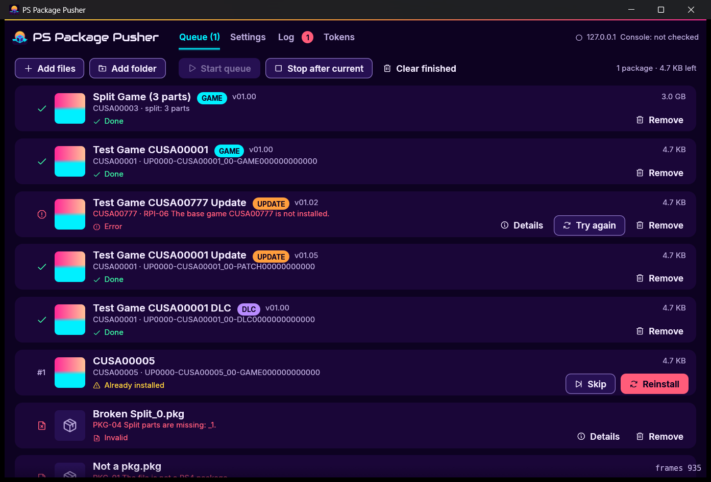
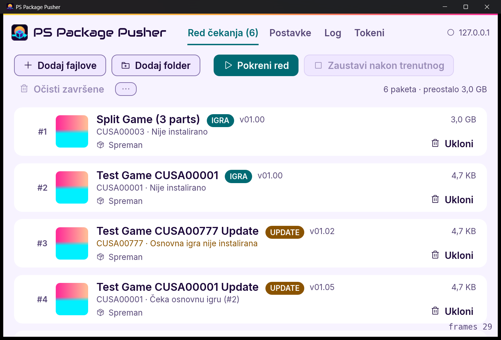
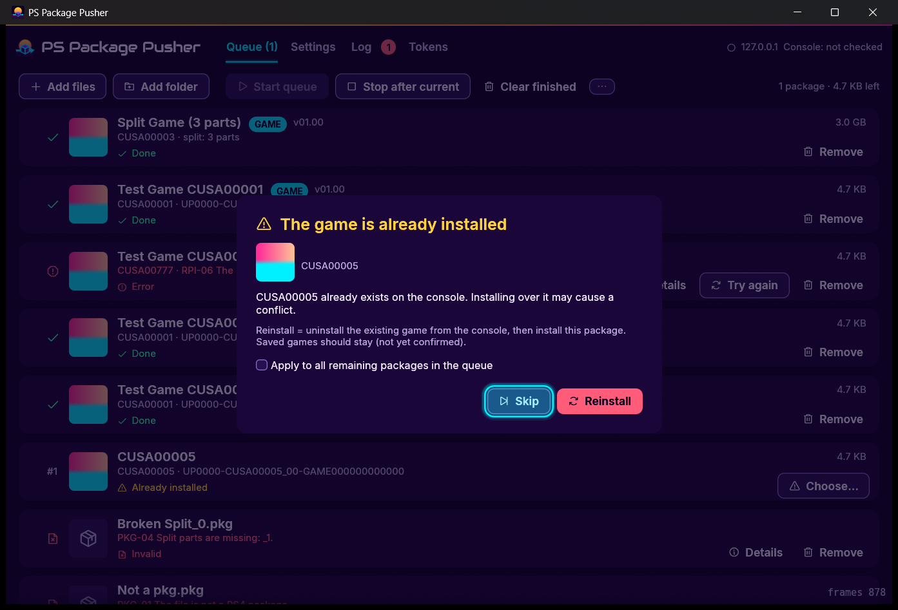
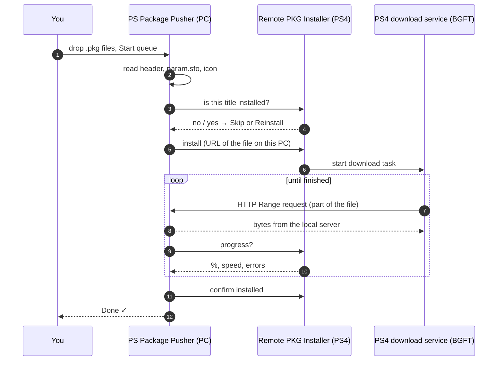

<p align="center"></p>

<h1 align="center">PS Package Pusher</h1>

<p align="center"><b>Send PS4 <code>.pkg</code> files from your Windows PC to a jailbroken PS4 — drag, drop, install.</b><br>
<sub>A Windows PKG sender / PC client for Remote PKG Installer 3.58 on GoldHEN or HEN: install PS4 games, updates and DLC over your local network, with a queue, checks before every install and clear errors.</sub></p>

<p align="center">
  <a href="https://github.com/pinkyBOZZ/PS-Package-Pusher/actions/workflows/ci.yml"></a>
  <a href="https://github.com/pinkyBOZZ/PS-Package-Pusher/releases"></a>
  
  <a href="LICENSE"></a>
</p>
<p align="center">
  
  
  
  
  
</p>

<p align="center">
  <a href="#-features">Features</a> ·
  <a href="#-how-it-works">How it works</a> ·
  <a href="#-quick-start">Quick start</a> ·
  <a href="#-troubleshooting">Troubleshooting</a> ·
  <a href="#-tech-stack">Tech stack</a> ·
  <a href="#-building-from-source">Build</a>
</p>

<p align="center"></p>

> **Disclaimer.** PS Package Pusher is an independent project. It is **not affiliated with, endorsed or sponsored by Sony Interactive Entertainment**. "PS4" is used only to describe compatibility. Use it only with your own legally made backups and homebrew. The software is provided "as is", without warranty of any kind (see [LICENSE](LICENSE)).

## 🚦 Project status

| | |
|---|---|
| **Version** | see [Releases](../../releases); the app shows its version at the bottom of Settings |
| **Works** | everything in the v1 feature list, tested end-to-end against a mock console |
| **Tested on a PS4** | RPI 3.58, with two PCs and three different PS4 consoles: install of game / update / DLC and homebrew apps, packages > 4 GB, pause / resume, cancel, resume after closing the app; see Known limitations below for what was not tested |
| **Next** | ideas for later versions: update check, finding the console on the network automatically |

## ✨ Features

| | |
|---|---|
| 📥 **Add anything** | Drag & drop files or whole folders, or **Add files / Add folder** (`Ctrl+O`). Split packages (`_0`, `_1`, …) become one item. |
| 🔎 **Knows the package** | Name, Title ID, version, type (game / update / DLC) and the game icon are read **locally from the package** — no internet. |
| 🛡️ **Checks first** | Before every install it asks the console: an installed game offers *Skip* or *Reinstall*, an update or DLC needs its game. |
| 📋 **Real queue** | Reorder, pause / resume / cancel, progress, speed and ETA. Survives restarts and resumes an interrupted transfer. |
| 🗑️ **Uninstall** | From the queue or by Title ID / Content ID — always with a confirmation. |
| 🧭 **Clear errors** | *What happened, why, what to do*, console error-code explanations and the console's own log. |
| 🔔 **Notifications** | While you are in another app, Windows tells you when an install fails or the queue is done; one click brings the app back. Can be turned off in Settings. |
| 🔥 **Firewall helper** | One click (plus Windows' UAC prompt) creates a narrow rule: one port, Private network, local subnet. |
| 🎨 **Feels good** | Follows the Windows light/dark theme, smooth animations (respects "Show animations"), splash screen, English and Bosnian. |

<p align="center">
  
  
</p>

## 🔄 How it works



1. The app reads everything it shows from the package itself.
2. It runs a small **local HTTP server** that only serves the queued packages, only to the console's IP.
3. It tells RPI to install from that URL; the console **pulls the file in parts** (Range requests, works for packages over 4 GB).
4. It polls RPI for progress and turns any failure into an error with an explanation.

## 📋 Requirements

- Windows 11 x64 (Windows 10 22H2 should work but is not tested).
- A jailbroken PS4 (GoldHEN / HEN) running **Remote PKG Installer 3.58** ([rawblue33 fork](https://codeberg.org/rawblue33/Remote-PKG-Installer-v3.53)), port `12801`.
- The PC and the console on the **same local network** (wired Ethernet recommended for big packages).

## 🚀 Quick start

1. Download `PS-Package-Pusher-<version>-win-x64.zip` from [Releases](../../releases), unzip it and start `ps-package-pusher.exe`.
2. Allow the firewall (see below) when the app or Windows asks.
3. On the PS4 start **Remote PKG Installer**; note the IP shown on the TV.
4. In **Settings** enter that IP (`12801` stays) and press **Test connection** (`F5`). The app also checks the connection at startup and after you save Settings; the header shows the console state.
5. Drop your `.pkg` files on the window and press **Start queue** (`Ctrl+Enter`).

### 🔥 Windows Firewall

The console downloads packages **from your PC** (local server, port `8095` by default), and Windows Firewall blocks that by default:

- When Windows shows *"Windows Security Alert"* for PS Package Pusher, tick **Private networks** and click **Allow access**, or
- use **Settings → Windows Firewall → Allow in firewall** (Windows asks for confirmation; the rule allows only that port, the Private profile and the local subnet).
- Your network must be set to **Private** (Settings → Network & internet). VPNs and router "AP/client isolation" can also block the console.
- On company-managed PCs a policy may ignore local rules (error `FW-04`).

### 🔐 SmartScreen and verifying the download

The executable is not code-signed, so Windows SmartScreen may say *"Windows protected your PC"*: click **More info → Run anyway**. Before that you can check the file against `SHA256SUMS.txt` from the release:

```powershell
Get-FileHash .\PS-Package-Pusher-<version>-win-x64.zip -Algorithm SHA256
```

Settings, the queue and logs live in `%APPDATA%\PS Package Pusher`. Logs replace your user folder with `%USERPROFILE%`, so they are safe to attach to an issue.

## 🩺 Troubleshooting

Every error has a code; the app shows the full explanation (and the console log where available) in the error dialog and in the **Log** tab.

<details>
<summary><b>All error codes</b> (click to expand)</summary>

| Code | What happened | What to do |
|---|---|---|
| `CFG-01` | The value is not an IPv4 address. RPI 3.58 rejects host names. | Enter the IP shown on the console screen (e.g. 192.168.1.50). |
| `CFG-02` | A settings file was damaged. It was saved as <file> and defaults were loaded. | Enter your settings again. Please report the bug with the file attached. |
| `CFG-03` | Invalid ID. | Title ID: 4 letters + 5 digits (CUSA12345). Content ID as shown on the package. |
| `FW-01` | The console accepted the install but never requested the file. It cannot reach this computer. | Allow the app in Windows Firewall (Private network), check that the network is Private, and turn off VPN or router AP isolation. |
| `FW-02` | Nothing was changed: the Windows confirmation was declined. | Click again and confirm, or use the Windows prompt. |
| `FW-03` | Windows did not accept the firewall rule: <detail> | Allow the app manually (see the firewall guide). |
| `FW-04` | This computer's firewall is managed by a policy (e.g. your company). Local rules have no effect. | Contact your administrator or use another computer. |
| `NET-01` | The console does not respond on <ip>:<port>. | Check that the console is on, RPI is running, the IP is correct and both devices are on the same network. |
| `NET-02` | The console is reachable, but RPI is not listening on port <port>. | Start RPI on the console. RPI 3.58 uses port 12801 (the old flatz version used 12800 and is not supported). |
| `NET-03` | RPI refused the request (HTTP 403). | Use the IP address, not a name. Turn off proxy/VPN. Report a bug with the log if it keeps happening. |
| `NET-04` | Something other than RPI is answering on that port. | Check the IP and port. |
| `NET-05` | This RPI version does not have the expected endpoint. | Install RPI 3.58 (rawblue33 fork). |
| `NET-06` | This computer has no route to the console. | Connect this computer to the same network, or enter the PC IP manually in Settings. |
| `PKG-01` | The file is not a PS4 package. | Check the file. |
| `PKG-02` | The package is damaged or incompletely downloaded. | Recreate or copy the package again. |
| `PKG-03` | param.sfo is missing or encrypted: name, version and type are unavailable. | Check the package. |
| `PKG-04` | Split parts are missing: <parts>. | Put all parts in the same folder. |
| `PKG-05` | This package is already in the queue (#<pos>). | No action needed. |
| `PKG-06` | Unknown package type <category>. | Installing is possible at your own risk. |
| `PKG-07` | The file changed or disappeared after it was added. | Remove the item and add it again. |
| `RPI-01` | The console refused the installation: <detail> | See the console log in the details. If the detail is `0x80990015`, an old download of this package is still on the console (older builds could leave it): delete it in Notifications → Downloads and try again. |
| `RPI-02` | Checking whether the title is installed failed. | Nothing is installed without this check. Try again. |
| `RPI-04` | Download/installation was aborted, code <detail>. | See the code explanation and the console log. |
| `RPI-05` | The transfer stopped (no progress for <secs> s). | Check the console (rest mode, free space) and try again. |
| `RPI-06` | The base game <title_id> is not installed. | Add and install the game before its update/DLC. |
| `RPI-07` | The connection to the console was lost. | Check the console. Try again resumes if possible. |
| `RPI-08` | Uninstall failed. With Reinstall, nothing was installed. | See the console log, or uninstall manually on the console. |
| `SRV-01` | Port <port> is used by another program. | Choose another port in Settings (a free one is suggested). |
| `SRV-02` | This computer's IP address changed. | Run the connection test and try again. |
| `SRV-03` | The file was moved, deleted or its disk disconnected while sending. | Restore the file or disk, or remove the item and add it again. |
| `SRV-04` | Reading from disk is very slow. The console aborts after 30 s of waiting. | Copy the package to a local SSD/HDD. |

</details>

Console error codes (`CE-…`, `0x8099…`) are explained where known; unknown ones are shown as-is — please report them with the log.

## ⚠️ Known limitations

- Remote PKG Installer has no "list installed titles" API, so uninstall works on items in the queue or on a typed Title ID / Content ID.
- Some RPI 3.58 behaviour is not confirmed yet (whether reinstalling keeps save data); the app tolerates both known variants of the JSON fields.
- Not tested on a console yet: split packages, save data after uninstall, rest mode during a transfer, a pulled network cable or removed USB disk during a transfer, and package types other than game, update, DLC and homebrew app (for example themes).
- A finished install is removed from the PS4 Downloads list about a minute after it completes. If you close the app within that minute, that entry stays; remove it in Notifications → Downloads.
- One console at a time; HTTP only on the local network (RPI does not support HTTPS).

## 🧰 Tech stack

| Area | What | Why |
|---|---|---|
| Language | **Rust 1.100** (edition 2024), static CRT | one small `.exe`, no runtime to install |
| UI | **egui / eframe 0.37** (glow), AccessKit | immediate-mode UI, no repaint when idle, screen-reader names |
| Talking to RPI | **ureq 3** | blocking HTTP client, explicit timeouts, no proxy |
| Serving packages | own HTTP server on `std::net` | Range > 4 GB, connection limit, IP filter |
| Packages | own PKG / param.sfo parser + **image** | fuzz-tested, reads only the header region |
| Windows | **windows-sys**, **rfd**, **winresource** | sleep blocking, UAC, file dialogs, tray notifications, icon + version info |
| Data | **serde_json** | `config.json` and `queue.json` with atomic writes |
| Fonts / icons | Inter, Audiowide, Phosphor | embedded in the exe |
| Quality | `cargo test`, clippy `-D warnings`, rustfmt, mock console | 58 automated tests |
| CI / release | GitHub Actions | tag → build, licenses, zip, SHA-256, GitHub release (stable tag: published as Latest; `-` tag: draft pre-release) |

## 🔧 Building from source

Requires Rust (see `rust-toolchain.toml`) and the MSVC build tools.

```powershell
cargo run --release
```

A mock console lets you try everything without a PS4:

```powershell
cargo run --bin mock-rpi -- --installed CUSA00001 --speed 20MB
```

Then set the console IP to `127.0.0.1` in Settings. `cargo run --example make_fixture -- <folder>` writes fake test packages (not installable on a real console). Tests: `cargo test`.

## 📜 License and credits

- MIT — see [LICENSE](LICENSE). Third-party licenses are in `THIRD-PARTY-LICENSES.txt` inside the release zip.
- Fonts: [Inter](https://github.com/rsms/inter) and [Audiowide](https://fonts.google.com/specimen/Audiowide) (SIL OFL 1.1); icons: [Phosphor](https://phosphoricons.com) (MIT).
- **flatz** — original Remote Package Installer; **rawblue33** — RPI 3.5x fork with the web dashboard and fixes.
